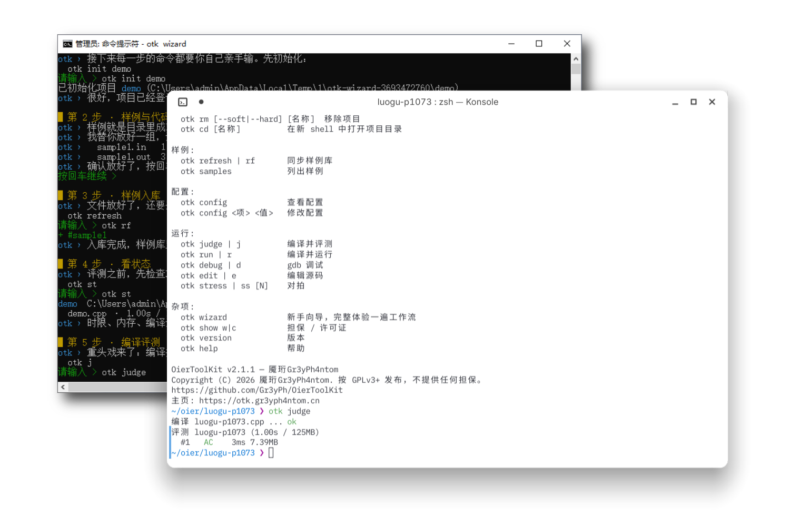

<p align="center">
  
</p>

<h1 align="center">OierToolKit</h1>

<p align="center">
  <strong>Cross-platform CLI toolkit for competitive programmers.</strong><br>
  本地评测 · 项目管理 · 样例管理 · 对拍<br>
  🌐 <a href="https://otk.gr3yph4ntom.cn">otk.gr3yph4ntom.cn</a>
</p>

<p align="center">


[中文](README.md) | [English](README.en.md)

一个为 Oier 量身定制的轻量级跨平台本地评测姬与题目管理工具。
~~叫做OierOperationSimplifier更合理吧。。~~

<p align="center">
  
</p>


## 🌟 特性
* **git 风格命令行**：一次性命令，执行完即退出；输出可安全重定向（非终端自动关闭颜色）。
* **项目库**：项目可以建在任意目录（`otk init`），统一登记到项目库中管理。
* **样例即文件**：目录里放成对的 `.in` 与 `.out`（比赛下发的 `.ans` 也认），`otk refresh` 一下即入样例库。
* **跨平台时空测量**：运行时间与峰值内存直接来自操作系统接口，不依赖 GNU time 等外部工具。
* **Diff 引擎**：`-v` 评测时 WA 对比期望与实际输出，RE 显示 stderr 信息。
* **对拍**：gen.cpp 造数据、brute.cpp 做标答，反例自动保存到 `.stress/`。
* **远程 OJ**：`otk fetch` 从支持 [otk-remote 协议](PROTOCOL.md)的 OJ 拉题入库，`otk submit` 本地提交、等到 verdict。
* **脚本可用**：存在非 AC 结果时退出码非零。


## 🚀 安装

一条命令安装（自动匹配平台与架构）：

```bash
# Linux / macOS
curl -fsSL https://otk.gr3yph4ntom.cn/install.sh | bash
```

```bat
# Windows（cmd / PowerShell 均可）
powershell -NoProfile -c "iwr -UseBasicParsing https://otk.gr3yph4ntom.cn/install.ps1 | iex"
```

手动安装也可以：从 release 页面下载预编译版放进 PATH；或 clone 本项目 `go build -o otk`。评测需要 `g++`，除此之外零外部依赖。


## 📖 快速上手

第一次上手可以运行 `otk wizard`，在临时目录里跟着引导亲手走一遍完整流程。

以 "输入两个整数，输出它们的和" 为例：

```bash
mkdir aplusb && cd aplusb
otk init                      # 当前目录建项目（默认用目录名）

echo "1 2" > sample1.in       # 样例就是目录里的文件对
echo "3" > sample1.out
otk refresh                   # 文件对入库

otk config editor "emacs -nw %s" # 设置全局编辑器命令
otk edit                      # 编写代码（默认 vim）
otk j                         # 编译并评测
# 编译 aplusb.cpp ... ok
# 评测 aplusb (1.00s / 125MB)
#   #sample1 AC    2ms 4.36MB
```

项目放在哪里都行，`otk init` 都会把它登记进项目库（`~/.otkprofile/registry`）：`otk ls` 统一查看，`otk cd <名称>` 随时跳转（exit 返回原目录）。`otk rm [--soft|--hard] [名称]` 默认软删除 OTK 元数据、对拍数据和编译产物，保留源码与样例；`--hard` 删除整个项目目录。

写错了就对拍：准备 gen.cpp 与 brute.cpp 后运行 `otk stress 100`，反例数据保存在 `.stress/` 中。

主要命令一览（`otk help` 查看完整帮助）：

| 命令 | 说明 |
|---|---|
| `otk init [名称]` | 当前目录初始化项目并登记 |
| `otk st` | 项目状态 |
| `otk ls / se <正则> / rm [--soft \| --hard] [名称]` | 项目库管理；rm 默认软删除，也可硬删除 |
| `otk cd [名称]` | 在新 shell 中打开项目目录 |
| `otk refresh (rf)` | 同步样例库（.in/.out 文件对入库） |
| `otk samples` | 列出样例 |
| `otk config [项 值]` | 查看/修改配置（项目项：time/memory/version/o2；全局项：editor） |
| `otk judge (j) [-v]` | 编译并评测全部样例；`-v` 显示报错与 WA 详情 |
| `otk fetch [url] <id>` | 从远程 OJ 拉取题目与样例（协议见 PROTOCOL.md） |
| `otk submit (sub) [-q]` | 提交源码到远端评测并等待结果；`-q` 只提交 |
| `otk run (r)` | 编译并运行 |
| `otk debug (d)` | gdb 调试 |
| `otk edit (e)` | 编辑源码（使用全局 editor 配置） |
| `otk stress (ss) [N]` | 对拍 N 轮（默认 100） |
| `otk wizard` | 新手向导，跟着引导走一遍工作流 |

## ✳️ 全局配置
全局配置和项目库固定存放在 `~/.otkprofile`。使用 `otk config editor "emacs -nw %s"` 设置编辑器命令，`%s` 会替换为当前项目的源码路径；默认使用 `vim %s`（Windows 使用 `notepad %s`）。

## 📋 TODO
- [x] 重构命令集
- [x] 添加更多样例和项目管理功能
- [ ] 集成模板库


---


**Copyright (C) 2026 魇珩Gr3yPh4ntom.**

logo.png 与 demo.png: Copyright (C) 2026 魇珩Gr3yPh4ntom. Licensed under the GNU General Public License, version 3 or any later version.

Copying and distribution of this file, with or without modification,
are permitted in any medium without royalty provided the copyright
notice and this notice are preserved.  This file is offered as-is,
without any warranty.

