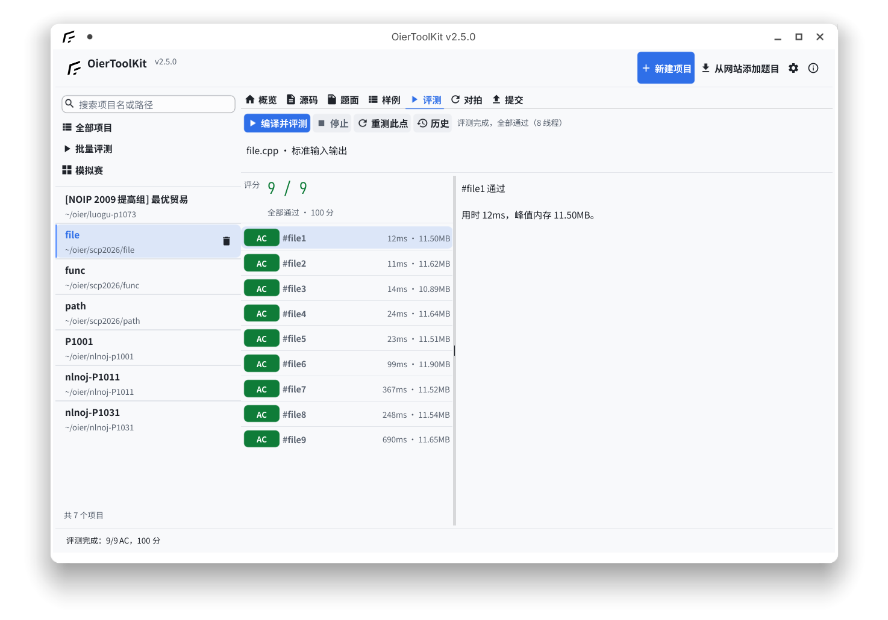

<p align="center">
  
</p>

<h1 align="center">OierToolKit</h1>

<p align="center">
  <strong>Cross-platform CLI toolkit for competitive programmers.</strong><br>
  本地评测 · 项目管理 · 样例管理 · 对拍<br>
  🌐 <a href="https://otk.gr3yph4ntom.cn">otk.gr3yph4ntom.cn</a>
</p>

<p align="center">


[中文](README.md) | [English](README.en.md)

一个为 Oier 量身定制的轻量级跨平台本地评测姬与题目管理工具。
~~叫做OierOperationSimplifier更合理吧。。~~

<p align="center">
  
</p>


## 🌟 特性

- **GUI 与 CLI**：同一份程序提供命令行和多标签页桌面界面。
- **项目与分组**：项目可放任意目录，通过项目库、分组树统一管理；支持名称和分组修改。
- **样例评测**：成对的 `.in/.out` 或 `.in/.ans` 可自动同步，支持 Diff、SPJ、对拍和评测历史。
- **模拟赛与远程题库**：支持导入模拟赛、并发评测、榜单导出，以及远端题目克隆与提交。
- **跨平台与更新**：支持 Linux、Windows、macOS；启动检查新版本并可在应用内更新。


## 🚀 安装

一条命令安装（自动匹配平台与架构）：

```bash
# Linux / macOS
curl -fsSL https://otk.gr3yph4ntom.cn/install.sh | bash
```

```bat
# Windows（cmd / PowerShell 均可）
powershell -NoProfile -c "iwr -UseBasicParsing https://otk.gr3yph4ntom.cn/install.ps1 | iex"
```

手动安装也可以：从 release 页面下载预编译版放进 PATH；或 clone 本项目 `go build -o otk`。评测需要 `g++`；GUI 基于 Fyne，从源码编译 GUI 需要 cgo 与各平台图形开发库（Linux 需 `libgl1-mesa-dev xorg-dev libxkbcommon-dev` 等），预编译版则开箱即用。

Windows 上两个入口要分别编译：`scripts/build-windows.sh` 会把 `otk.exe` 编成 console 子系统（能敲命令）、`otk-gui.exe` 编成 windows 子系统（双击不弹黑框）。子系统的选择发生在链接期，同一份二进制没法在启动时切换，所以发行包里是两份 exe；两份都带 `resource_windows_amd64.syso` 提供的图标与版本信息，所以在资源管理器里看起来完全一样。


## 📖 快速上手

第一次上手可以运行 `otk wizard`，在临时目录里跟着引导亲手走一遍完整流程。

以 "输入两个整数，输出它们的和" 为例：

```bash
mkdir aplusb && cd aplusb
otk init                      # 当前目录建项目（默认用目录名）
otk init -t stress 对拍练习    # 连 gen.cpp / brute.cpp 一起生成

echo "1 2" > sample1.in       # 样例就是目录里的文件对
echo "3" > sample1.out
otk refresh                   # 文件对入库

otk config editor "emacs -nw %s" # 设置全局编辑器命令
otk edit                      # 编写代码（默认 vim）
otk j                         # 编译并评测
# 编译 aplusb.cpp ... ok
# 评测 aplusb (1.00s / 125MB)
#   #sample1 AC    2ms 4.36MB
```

项目放在哪里都行，`otk init` 都会把它登记进项目库（`~/.otkprofile/registry`）：`otk ls` 统一查看，`otk cd <名称>` 随时跳转（exit 返回原目录）。在项目目录内可用 `otk config name "显示名称"` 修改项目名称，用 `otk config group "分组名"` 修改分组；传空值或 `-` 可分别恢复目录名或清除分组。`otk rm [--soft|--hard] [名称]` 默认软删除 OTK 元数据、对拍数据和编译产物，保留源码与样例；`--hard` 删除整个项目目录。

写错了就对拍：准备 gen.cpp 与 brute.cpp 后运行 `otk stress 100`，反例数据保存在 `.stress/` 中。

主要命令一览（`otk help` 查看完整帮助）：

| 命令 | 说明 |
|---|---|
| `otk init [-t 模板] [名称]` | 当前目录初始化项目并登记；`-t` 选模板（空白 / 读入输出 / 多测 / 文件读写 / 对拍三件套） |
| `otk st` | 项目状态 |
| `otk ls / se <正则> / rm [--soft \| --hard] [名称]` | 项目库管理；rm 默认软删除，也可硬删除 |
| `otk cd [名称]` | 在新 shell 中打开项目目录 |
| `otk refresh (rf)` | 同步样例库（.in/.out 文件对入库） |
| `otk samples` | 列出样例 |
| `otk config [项 值]` | 查看/修改配置（项目项：time/memory/version/o2/cflags/spj 等；全局项：editor） |
| `otk config remote ls \| add \| token \| rm` | 管理多个远端，每条远端有独立地址与令牌 |
| `otk config export \| import` | 把 `~/.otkprofile` 的配置打包成几十 KB 的 zip 搬到另一台机器；默认不含令牌与项目库 |
| `otk judge (j) [-v] [样例...]` | 编译并评测样例；`-v` 显示报错与 WA 详情；指定样例号只测该点 |
| `otk history (his) [次数]` | 查看最近几次评测结果 |
| `otk clone [-r 远端名] [url] <id>` | 从网站添加题目：标题、题面、样例到 `<oj>-<题号>` 目录并初始化（协议见 PROTOCOL.md） |
| `otk submit (sub) [-q]` | 提交源码到远端评测并等待结果；`-q` 只提交 |
| `otk run (r)` | 编译并运行 |
| `otk debug (d)` | gdb 调试 |
| `otk edit (e)` | 编辑源码（使用全局 editor 配置） |
| `otk stress (ss) [N]` | 对拍 N 轮（默认 100） |
| `otk pack (pk) [目录] [输出.zip]` | 把项目打包成 zip（源码 + 样例 + `.otk` 配置，不含编译产物） |
| `otk wizard` | 新手向导，跟着引导走一遍工作流 |
| `otk completion bash\|zsh\|powershell` | 输出 shell 补全脚本（source 进配置文件即可） |
| `otk gui` | 打开图形界面（项目库、样例、评测、对拍、提交一站搞定）；安装脚本还会生成 `otk-gui` 入口，双击即进 GUI |
| `otk contest add/export/dup/judge/rank/rm` | 模拟赛：导入比赛（目录或 zip）、打包搬家、复制副本、并发评测、查看与导出榜单 |

## 🏆 模拟赛

`otk contest` 用来一次性评测一整场比赛：多道题、多位选手、subtask 捆绑给分，最后出榜单。

**上传目录结构**（题目数据与选手源码各一份，整目录导入即可）：

```
某次模拟赛/
├── data/
│   ├── aplusb/
│   │   ├── 1.in  1.ans      # 测试点：.in + .ans（也认 .out）
│   │   └── 2.in  2.ans
│   └── maxsub/
│       └── ...
└── source/
    ├── 张三/
    │   ├── aplusb.cpp       # 选手名/题目名.cpp
    │   └── maxsub.cpp
    └── 李四/
        └── aplusb.cpp
```

```bash
otk contest add ~/Downloads/某次模拟赛     # 导入（目录名即比赛名，可用 -n 指定）
otk contest judge                          # 并发编译 + 评测（默认 NumCPU-1，上限 8）
otk contest rank                           # 终端里看榜单
otk contest rank -w rank.html              # 导出完整榜单页（含每题明细矩阵）
otk contest export 某次模拟赛 out.zip      # 打包成 zip 数据包（不带评测结果）
otk contest dup 某次模拟赛 改动版          # 复制一场比赛，随便改不影响原件
otk contest add out.zip                    # 在另一台机器上原样导入
otk contest rm <id>                        # 删除比赛
```

**数据包**：`export` 打出的 zip 里是 `contest.json` + `data/` + `source/`，所以时限、子任务、题面、选手与提交清单都跟着走，换台机器导入不用再配一遍。`result.json` 和 `.build/` 不进包——评测结果跟本机编译器绑定，导入后重新评测才有意义。没有 `contest.json` 的普通上传目录 zip 也认，会当成目录导入重新扫描。

**subtask** 在比赛目录的 `contest.json` 里配置，也可以在 GUI 的「题目配置」页直接改（改完自动写回）：

| 模式 | 含义 |
|---|---|
| `all` | 捆绑测试：该子任务下所有测试点都通过才给分 |
| `any` | 任意通过：只要有一个测试点通过就给满该子任务分 |
| `sum` | 按比例给分：通过多少个点就给多少比例的分 |

**GUI**：打开图形界面，左侧点「模拟赛」进入比赛列表，工作台分四个标签页 —— 榜单（可导出 HTML）、题目配置（可视化增删题目/子任务/测试点分值）、选手与提交（补交源码、改名、删除）、评测日志（实时进度与每份提交的详细结果）。评测进度只显示一行百分比，不会挤压侧边栏。

## ✳️ 全局配置
全局配置和项目库固定存放在 `~/.otkprofile`。使用 `otk config editor "emacs -nw %s"` 设置编辑器命令，`%s` 会替换为当前项目的源码路径；默认使用 `vim %s`（Windows 使用 `notepad %s`）。

## 📋 TODO
- [x] 重构命令集
- [x] 添加更多样例和项目管理功能
- [ ] 集成模板库

## 🤝 贡献者

- [魇珩Gr3yPh4ntom](https://github.com/Gr3yPh) — 项目发起与维护；命令行工具链、核心评测引擎、远程 OJ 协议
- [YANGRENRUIYRR](https://github.com/YANGRENRUIYRR) — 图形界面、模拟赛系统、评测增强（SPJ、评测历史、多远端）、英文翻译等

提交贡献即表示同意以 GPLv3+ 授权本项目。

[](https://github.com/Gr3yPh/OierToolKit/graphs/contributors)


---


**Copyright (C) 2026 魇珩Gr3yPh4ntom and contributors.**

logo.png 与 demo.png: Copyright (C) 2026 魇珩Gr3yPh4ntom. Licensed under the GNU General Public License, version 3 or any later version.

题面数学公式由 [go-tex](https://github.com/luo-studio/go-tex) 渲染（MIT License）。

Copying and distribution of this file, with or without modification,
are permitted in any medium without royalty provided the copyright
notice and this notice are preserved.  This file is offered as-is,
without any warranty.

